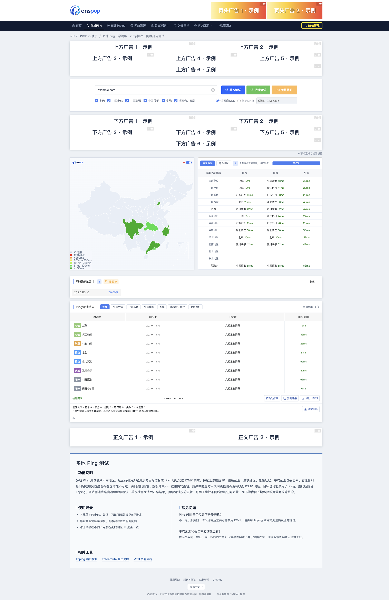
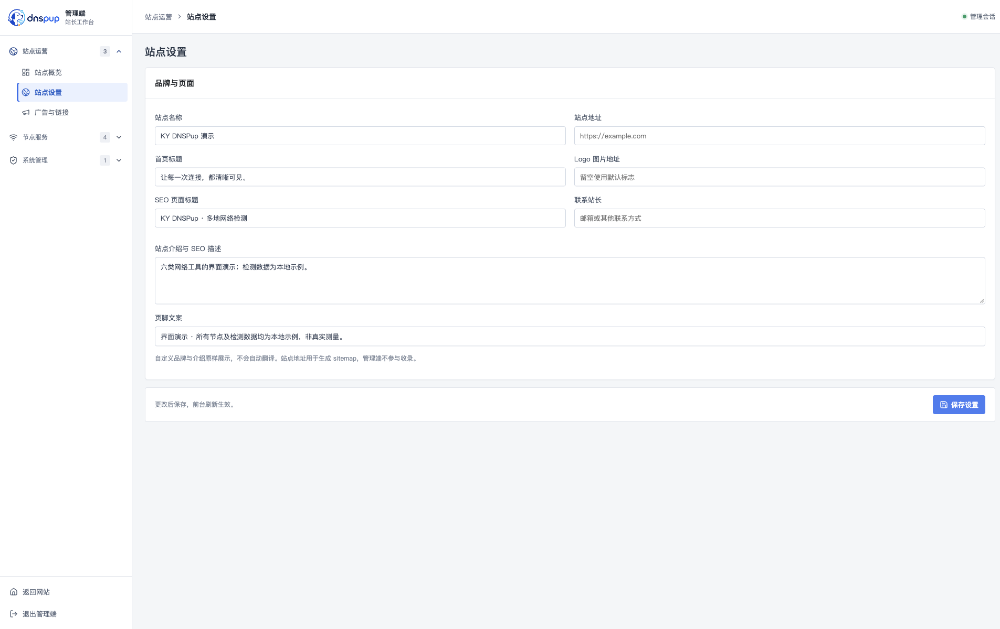
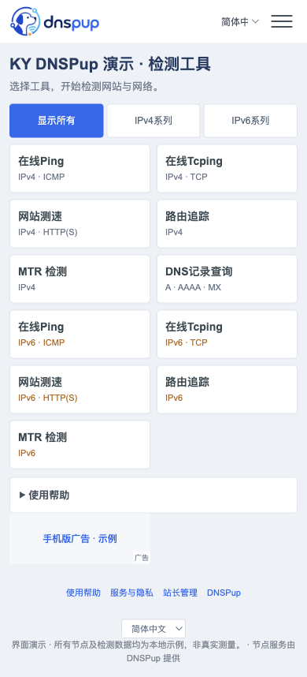

# KY DNSPup — ITDOG 风格拨测 / Ping 测试建站程序

面向想自行搭建 ITDOG 类在线 Ping、多地拨测、TCPing 和网站测速站的站长。KY DNSPup 提供检测前台、站长管理端和 DNSPup 客户 API 对接，可使用自己的域名、站点名称和广告位。

**ITDOG 仅用于描述同类产品和使用场景。本项目与 ITDOG 无官方关联，不是 ITDOG 官方开源版，也不包含 ITDOG 的节点服务。** 本项目的节点检测由 DNSPup API 提供，首次使用需要在 DNSPup 注册并开通 API 授权。项目代码以 [MIT 许可证](LICENSE) 开源；节点服务的费用与授权单独计算。

## 界面预览

当前版本 **0.1.1**：修复手机历史记录遮挡检测按钮，并使地区地图按最快有效响应着色。详见 [更新记录](CHANGELOG.md)。

[查看完整截图册：前台与管理端 24 个页面、48 张桌面/手机截图](docs/screenshots/README.md)，也可在本地浏览器打开 [可切换截图册](docs/screenshots/index.html)。

以下截图由当前程序在隔离演示环境中实际渲染，沿用原有 UI。Ping 结果使用 `example.com` 与测试节点的示例数据，仅展示界面，不代表线上真实测量；广告位为站长可自行配置的示例内容；截图不包含真实账户、API 凭据或客户数据。

### 桌面 Ping 检测



### 站长管理端



### 移动端工具首页



## 功能

| 功能 | 支持范围 |
| --- | --- |
| 六类检测 | Ping、TCPing、HTTP、DNS、Traceroute、MTR |
| 节点与协议 | IPv4 / IPv6、节点筛选、线路选择；实际能力以 API 授权及节点目录为准 |
| 结果展示 | 地图、统计、表格、排序、复制、JSON 导出；桌面完整截图与目标/位置遮罩 |
| 持续测试 | Ping / TCPing 按轮次检测，可停止后续轮次；每轮独立计量 |
| 任务恢复 | 异步任务进度、同一页面刷新恢复、保存上游任务编号后重启恢复 |
| 站长管理 | 品牌与 SEO、工具开关与顺序、默认节点、广告、友情链接、配置导入导出 |
| 接入管理 | API 凭据加密保存、连接测试、账户额度、调用记录、脱敏诊断 |
| 访问保护 | 来源频率、单次节点数、每日提交数、并发限制、重复请求保护 |
| 多语言 | 简体中文、繁体中文、英语、日语、韩语；管理端为中文 |

当前仅对接 DNSPup 客户 API。节点 Agent、平台调度、节点运营与订阅计费系统不在此程序中。批量检测、本地网络、监控任务和用户中心不属于当前六类工具范围；HTTP 版本、指定解析等高级选项以页面可用状态和 API 契约为准。

## 本机启动

需要 **Node.js 24 或以上版本**。取得源码后，在项目根目录执行：

```sh
npm ci
npm run build
npm start
```

访问 [前台](http://127.0.0.1:4178/) 和 [管理端](http://127.0.0.1:4178/admin)，设置至少 12 个字符的管理员密码。默认只监听本机，没有默认管理员密码或预置 API 凭据。未连接节点服务时不能发起真实检测。

**管理端没有用户名字段，也没有 `admin/admin` 之类的默认账号。** 首次安装由站长创建密码，之后只输入这个密码登录。公网安装需要额外填写 `.env` 中的 `KY_SETUP_TOKEN` 完成首次初始化；它不是登录密码。DNSPup 注册账号和 API Key / Secret 也不用于登录本站管理端，详见 [管理员初始化与登录](docs/deployment.md#管理员初始化与登录)。

开发启动使用 `npm run dev`，自动化验证使用 `npm test`。运行数据写入 `var/`。`npm start` 不自动加载 `.env`；带环境文件启动和公网 HTTPS 设置见 [安装与部署](docs/deployment.md)。

## Linux Docker 安装

需要 Docker Engine、Compose V2 和 `openssl`。镜像由本地源码构建，不依赖预先发布的镜像。

```sh
chmod +x scripts/deployment.sh
./scripts/deployment.sh init
# 编辑生成的 .env，设置自己的 KY_PUBLIC_ORIGIN 和镜像标签
vi .env
docker compose config --quiet
docker compose build app
./scripts/deployment.sh prepare
docker compose up -d --no-build --wait --wait-timeout 90 app
curl --fail http://127.0.0.1:4178/api/health
```

默认使用 Linux host 网络，仍只监听本机回环地址；使用同机 Nginx 提供 HTTPS。初始化令牌仅写入权限为 `600` 的 `.env`，不会打印。首次打开自己域名的 `/admin` 时，将 `.env` 中 `KY_SETUP_TOKEN=` 等号后的值填入「初始化令牌」，再另设管理员密码。它用于防止公网访客抢先创建管理员，不是登录密码或 DNSPup API 密钥；日常登录只用自设密码。初始化后仍保留 `.env` 中的令牌供 Compose 配置校验使用。具体获取、填写和排错见 [KY_SETUP_TOKEN 说明](docs/deployment.md#ky_setup_token-是什么怎么填写)；完整的证书、反向代理、备份、升级和回滚步骤见 [部署文档](docs/deployment.md)。

## 获取并连接节点 API

调用链：访客浏览器 → KY DNSPup 服务端 → DNSPup 客户 API → 探测节点。

1. 在 DNSPup [注册](https://dnspup.com/user/register/)或[登录](https://dnspup.com/user/login/)。DNSPup 账号与本站管理员账号独立。
2. 进入[用户中心 → API 密钥](https://dnspup.com/user/api-keys/)，联系管理员申请试用或开通 API，确认工具、节点、额度、有效期和来源绑定。
3. 将取得的 API Key / Secret 填入本站「节点服务 → 节点 API」，选择授权的固定公网出口 IP 或域名签名方式。
4. 保存后点击「测试已保存的连接」，核验成功后手动发起首次检测。

API 地址为 `https://api.dnspup.com/v1`。客户凭据由本站服务端保存和使用，不下发给访客浏览器。详见 [接入指南](docs/onboarding.md) 与 [API 契约](docs/reference/customer-api-v1.md)。

## 计量与任务恢复

API 检测按平台规则消耗请求额度；部署本程序不包含免费无限节点。具体价格、授权和用量以 DNSPup 账户为准。本站的每日提交数用于访问保护，不是扣费账单。

支持异步模式时，同一请求编号用于幂等创建；任务进度来自实际完成节点数。保存上游任务编号后，刷新或重启只查询原任务，查询不增加检测额度。平台完整结果保留 24 小时、幂等记录保留 30 天；本站调用记录保留 7 天，完整结果只做短期内存缓存。

创建响应丢失且未取得任务编号时，状态为「未知」，不会自动重新检测。主动发起新检测或持续测试的新一轮使用新的编号，可能再次计量。任务完成不代表每个节点都测量成功。兼容旧同步 API 时，执行中重启无法保证找回结果。具体边界见 [异步任务与恢复](docs/platform-job-adapter.md)。

## 文档

- [安装、HTTPS、备份、升级与回滚](docs/deployment.md)
- [注册、API 接入与首次检测](docs/onboarding.md)
- [任务查询与诊断](docs/task-diagnostics.md)
- [异步适配、结果恢复与幂等边界](docs/platform-job-adapter.md)
- [DNSPup 客户 API 契约](docs/reference/customer-api-v1.md)

配置导出不包含管理员密码和客户凭据。真实 `.env`、`var/`、备份、运行日志和检测结果应由站长私密保管，不能提交到公开仓库。

## 许可证与素材

项目代码使用 [MIT 许可证](LICENSE)，第三方依赖保留各自许可，详见 [第三方声明](THIRD_PARTY_NOTICES.md)。**中国地图数据来自 DataV / 高德，仅供学习和交流使用，不属于本项目的 MIT 授权范围。** 其他用途或分发权限请向原权利人确认。

安全与凭据保管见 [SECURITY.md](SECURITY.md)。维护者准备源码包时使用 `npm run release:prepare`；它只导出逐文件白名单，不包含本地配置、凭据和运行数据。来源声明不扩大原权利人的许可，地图使用限制以上述第三方声明为准。
